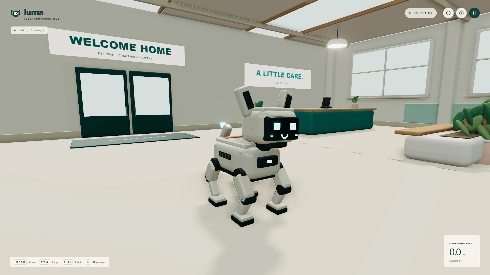

# LUMA · Robot Companion Club

A small robotic companion in a sunlit indoor playground. Wander through a furnished shelter, try the agility ramp, or settle into a quiet corner. There are no missions, scores, accounts, or downloaded model packs: the robot, room, signage, materials, and soundscape are built procedurally.

**Project URL:** [alfiansm07.github.io/luma-robot-companion-club](https://alfiansm07.github.io/luma-robot-companion-club/) — deployment verification is in progress.



## Run locally

Use **Node.js 22.12 or newer**, npm, and a current browser with **WebGL 2** and hardware acceleration. Web Audio is optional for gameplay, but needed for sound. Serve the app over HTTP(S); opening `index.html` through `file://` is not supported.

```sh
npm install
npm run dev
```

Open the local URL printed by Vite. The development server binds to all interfaces, so a phone on the same trusted network can use the computer's LAN address and the displayed port, subject to firewall rules.

```sh
npm run lint       # ESLint
npm test           # Vitest unit tests, one run
npm run build      # Production output in dist/
npm run preview    # Serve the production build locally
```

Use `npm ci` instead of `npm install` for a clean, lockfile-based CI installation. Preview serves an existing build; rebuild after source changes. Optional formatting commands are `npm run format:check` and `npm run format`.

## Play

Click **Let's play** to enter and allow the browser to start sound.

### Keyboard and mouse

| Input                                      | Action                                                                      |
| ------------------------------------------ | --------------------------------------------------------------------------- |
| **W / A / S / D**                          | Move relative to the camera; diagonals are normalized                       |
| **Space**                                  | Jump when grounded; holding the key does not repeatedly jump                |
| **Shift**                                  | Hold while moving to sprint                                                 |
| **Left- or right-button drag** on the room | Orbit the third-person camera                                               |
| **Mouse wheel**                            | Zoom in or out                                                              |
| **Esc**                                    | Pause/resume; in Settings or Controls, return to the preceding menu first   |
| **H**                                      | Open/close the controls guide; opening it during play pauses the simulation |
| **F3**                                     | Toggle the live FPS display                                                 |

Movement has acceleration, braking, camera-relative steering, gravity, slope handling, and a grounded jump rather than direct position teleportation. The camera uses sphere casts against the same physics world to shorten its follow distance near obstacles. Nominal movement tuning is 3.6 m/s walking and 6.4 m/s sprinting; acceleration and collisions affect measured speed.

### Touchscreen

- Drag the **left virtual joystick** to move.
- Drag an uncovered part of the room with **one finger** to orbit.
- **Pinch with two fingers on the room** to zoom.
- Tap **Jump** for a grounded jump.
- Hold **Sprint** while using the joystick to run.
- Use the top-right **Pause**, **Settings**, and **Controls** buttons instead of keyboard shortcuts.

Gamepads are **not supported**. The input system uses keyboard, mouse, and touch/pointer events; there is no hidden controller mapping.

### Pause, restart, and preferences

- The welcome view is paused. Opening Pause, Settings, or Controls stops physics, animation, and audio. The static preview redraws only when settings/size change or briefly while the camera settles.
- Hiding the tab cancels rendering and pauses an active session. Returning does **not** advance missed simulation time or automatically resume play. Choose **Keep exploring** or press Esc from Pause.
- Losing focus clears held inputs, as do pause and touch cancellation, to avoid stuck movement.
- **Start from the entrance** in the pause menu resets the player, dog animation, camera, and audio state, then resumes. It does not discard preferences.
- Settings apply immediately and are stored, with first-visit help acknowledgement, in browser `localStorage` under `luma.settings.v1`. Storage is per origin/browser profile; it is not cloud sync or a position save. If storage is unavailable or malformed, play and in-memory settings remain available.

| Preference                          | Range / default                              |
| ----------------------------------- | -------------------------------------------- |
| Graphics quality                    | Auto, Low, Medium, High, Ultra; default Auto |
| Soft shadows                        | On by default                                |
| Finishing touches / post-processing | On by default                                |
| Camera sensitivity                  | 0.2–2×; default 1×                           |
| Field of view                       | 45–85°; default 60°                          |
| Invert vertical camera              | Off by default                               |
| Master volume                       | 0–100%; default 80%                          |
| Music volume                        | 0–100%; default 35%                          |
| Companion & surroundings            | 0–100%; default 75%                          |
| Live FPS display                    | Off by default; also toggled by F3           |

Master affects every source. Music affects the score; Companion & surroundings includes ambience, footsteps, servo movement, jump/landing effects, and positional emitters. Audio starts only after a Play/Resume user gesture. When Web Audio is unavailable or denied, a dismissible notification explains the issue and the playground remains usable silently.

## Graphics and implementation

### Stack

- **Vanilla JavaScript ES modules, HTML, and CSS**; no React or other UI/game framework.
- **Three.js 0.186.1** for WebGL 2 rendering and its bundled post-processing utilities.
- **Rapier `@dimforge/rapier3d-compat` 0.21.0** for actual WASM physics, fixed colliders, the kinematic capsule controller, and camera shape casts.
- **Vite 8** for development and production bundling; ESLint, Vitest, and Prettier for source tooling.
- Browser **Web Audio**, through Three's audio classes and generated buffers, for original music, ambience, pooled sound effects, and positional sound.

Physics advances at **60 fixed steps per second** with render interpolation. Input is sampled once per rendered frame, and a pending jump is retained until a physics step consumes it. Pausing and visibility changes clear accumulated time.

The renderer uses physically based materials, a generated PMREM room environment, directional/hemisphere lighting, PCF shadow maps, ACES tone mapping, and sRGB output. With post-processing enabled, the pipeline is scene render → optional reduced-resolution SSAO → optional restrained bloom → SMAA → output transform. **This is rasterized WebGL rendering, not real ray tracing or path tracing.**

### Quality presets

The current values in [`src/rendering/quality.js`](src/rendering/quality.js) are:

| Preset | Maximum DPR | Drawing-buffer pixel budget | Shadow map | SSAO resolution / samples | Bloom |
| ------ | ----------: | --------------------------: | ---------: | ------------------------- | ----- |
| Low    |        1.00 |                   1,000,000 |      1024² | Off                       | Off   |
| Medium |        1.35 |                   2,100,000 |      2048² | 50% per dimension / 12    | On    |
| High   |        1.75 |                   2,800,000 |      2048² | 65% per dimension / 16    | On    |
| Ultra  |        2.00 |                   4,200,000 |      4096² | 80% per dimension / 24    | On    |

The drawing-buffer ratio is the minimum of device DPR, the tier's DPR ceiling, and the square root of pixel budget divided by CSS viewport area, with a floor of 0.35. At exceptionally large viewport sizes that floor can exceed the nominal pixel budget. Post-processing adds its own render targets; the table is not a total GPU-memory cap.

Shadow and post-processing toggles are independent of the tier. Low still uses SMAA when post-processing is on; turning off Finishing touches bypasses the entire composer. Auto is selected once from available device/GPU hints, not continually changed in response to FPS: mobile, software rendering, or very limited CPU/memory selects Low; detected integrated/mobile GPU hints or lower memory select Medium; otherwise High. Ultra is explicit opt-in. Missing browser hardware information makes these hints approximate, not a benchmark or a performance guarantee.

### Procedural assets and batching

The 36 × 44 m shelter contains original architecture, rest/care/lounge areas, agility equipment, plants, ceiling details, toys, and generated signs. The articulated robot is constructed from geometry and animated in code. The scene does not fetch external GLB/GLTF models, image texture packs, HDRIs, fonts, or audio recordings.

Static shelter geometry is batched rather than left as hundreds of separate primitive meshes. Procedural signage is atlas-packed. The robot's animated parts and other moving objects remain independently transformable. See `src/world/BatchBuilder.js` and `src/world/Shelter.js` for the actual batching strategy.

**Draco and KTX2 are not applicable to this asset pipeline:** there are no transferred model meshes or authored image texture sets to compress. Adding a decoder without such payloads would add a download rather than save one. Three's bundled SMAA area/search lookup images are a technical antialiasing dependency, not original artwork or an externally downloaded asset pack; their provenance is recorded in [CREDITS.md](CREDITS.md).

### Loading and Rapier WASM

The loading bar reports completed work, not a timer or simulated network progress:

1. Actual dynamic module imports account for the first 60%. Their weights are Lighting engine **2**, Physics engine **4**, and Shelter workshop, Companion controller, Robot articulation, Camera system, and Sound studio **1 each**.
2. Successful physics initialization advances to **73%**.
3. Completed shelter construction advances to **84%**.
4. Player, robot, camera, and input setup plus initial floor settling advance to **92%**, labelled Warming materials.
5. Supported parallel shader compilation (or synchronous compilation on other browsers) and the first render complete before **100% / Ready to meet Luma**.

These are weighted preparation milestones, **not byte-accurate download percentages**. Sound buffers are generated at the first audio-unlocking user gesture, not downloaded during this bar. A startup failure displays an error and reload action rather than falsely reporting readiness.

[`build/rapierWasm.js`](build/rapierWasm.js) is a Vite pre-transform for the pinned Rapier compat package. It extracts the **exact inline base64 WASM bytes** from Rapier's `dist/rapier.mjs` into a separately emitted, content-hashed `rapier-….wasm` production asset. The transformed initializer receives the supported wasm-bindgen object form, `{ module_or_path: fetch(assetURL) }`. Development serves those same bytes at `/__luma_physics.wasm` with `application/wasm` and `no-cache`.

The plugin does **not** mutate `node_modules`, patch a binary, replace physics with a stub, or depend on a postinstall edit. It requires exactly one recognized initializer and fails the build if the upstream layout changes. Review it when upgrading Rapier. Vite resolves the emitted asset URL against the deployment base path.

The game build is approximately **1.46 MB total gzip**; this is an aggregate compressed build-size estimate, not a measured cold-load transfer, load-time promise, or screenshot size. Actual transfer depends on host compression, caching, and the chunks requested. Physics and Three are separated into build chunks, and the WASM binary is independently cacheable.

## Source map

```text
src/
  main.js                 Boot sequence, lifecycle, integration, opt-in diagnostics
  core/                   Renderer, fixed-step loop, input, settings, weighted loader
  physics/                Rapier world, static colliders, camera sphere casts
  player/                 Kinematic controller, robot model, animation/movement math
  camera/                 Smoothed third-person camera and orbit/collision math
  world/                  Shelter geometry, batching, materials, signs and shaders
  rendering/              Quality presets and post-processing pipeline
  audio/                  Web Audio manager and original procedural synthesis
  ui/                     Accessible DOM menus/HUD, touch controls and styling
  **/*.test.js            Unit tests beside the corresponding modules
build/rapierWasm.js        Build-time extraction of Rapier's embedded WASM
public/assets/screenshots/
  gameplay.webp           Gameplay screenshot used above
.github/workflows/
  deploy.yml              Validate, build and deploy to GitHub Pages
vite.config.js            Base path, WASM plugin, code splitting and test discovery
netlify.toml              Alternative static hosting configuration
vercel.json               Alternative static hosting configuration
```

## Deploy

This is a static client-side application. Deploy the **contents of `dist/`**, not the source directory. It needs no API server, secret keys, database, or cross-origin isolation headers.

### GitHub Pages

The included [workflow](.github/workflows/deploy.yml) runs on pushes to `main` and manual dispatch:

1. Install Node 22 and dependencies with `npm ci`.
2. Run lint and unit tests.
3. Configure Pages and build with `VITE_BASE_PATH` set from `actions/configure-pages`'s `base_path`, plus the trailing slash.
4. Upload `dist/` and deploy with the official Pages actions.

In the repository's **Settings → Pages**, use **GitHub Actions** as the build/deployment source. The workflow has the required `pages: write` and `id-token: write` permissions and serializes Pages deployments. For this project-site URL, the effective production base is `/luma-robot-companion-club/`; a root domain normally uses `/`.

For a manual build under a subdirectory, set `VITE_BASE_PATH` before building. For example, in PowerShell:

```powershell
$env:VITE_BASE_PATH = '/luma-robot-companion-club/'
npm run build
npm run preview
```

Open the matching subpath in preview. Clear the variable or use `/` before building for a root-hosted alternative. The base is baked into the build; moving the same output to a different mount path can break JS and WASM requests.

**Pages limitation:** repository files do not provide arbitrary response-header or cache-control configuration for GitHub Pages. The Vercel/Netlify header files are not applied there. Hashed Vite assets permit safe cache busting, but the Pages service controls compression, MIME responses, and cache lifetimes. Inspect the deployed network responses; do not assume an immutable cache policy merely because the filename is hashed.

### Vercel or Netlify

Both alternative configurations use `npm run build` and publish `dist`:

- **Vercel:** import the repository, use the Vite preset and Node 22 or newer, and retain `vercel.json`.
- **Netlify:** import the repository and retain `netlify.toml`, which also selects Node 22.
- For ordinary root hosting, leave `VITE_BASE_PATH` unset (`/`). Configure a different base only if the host actually serves that subdirectory.

The included files request year-long immutable caching under `/assets/`, revalidation for `/`, and a WASM MIME type of `application/wasm`. Their KTX2/GLB MIME entries are hosting allowances, **not claims that the app ships those formats**. Files copied from `public/` are not automatically content-hashed by Vite; change the filename when replacing a public asset covered by an immutable rule. Host rules and compression are platform-dependent: verify actual responses after deployment. Vite's local preview is a build smoke test, not a production CDN configuration test.

## Verification and manual QA

### Recorded development evidence

The final development checks passed **lint, 56 tests, and production build**. Tests include movement/camera/animation/settings logic plus real-Rapier regressions for ramp stalls and ultrawide camera clearance.

Runtime verification covered Edge 155, Firefox 157, WebKit 27.2, and Chromium 156 touchscreen emulation. Keyboard movement, sprint, grounded jump/landing, orbit/zoom, pause/resume/restart, controls, settings persistence/volume, and resize were exercised. Trusted touch events verified joystick, simultaneous sprint, orbit, pinch, and jump. Firefox and WebKit startup/Play on the corrected build produced no console errors or warnings; Windows WebKit lacks Web Audio and correctly shows the unavailable-audio notice.

Real Rapier smoke scenarios passed **25 movement/jump/wall/reset checks**. A **60,480-frame** camera matrix covering wall/corner/roof anchors, FOV 45/60/85 and portrait through 32:9 aspect ratios recorded zero near-plane violations (minimum tested gap 0.131 m). The actual shelter ramp was climbed and descended at walk and sprint with no airborne frames or stalls; minimum capsule-center height was 0.8079 m.

| Measurement                |                                               Observed result | Scope                                                                                   |
| -------------------------- | ------------------------------------------------------------: | --------------------------------------------------------------------------------------- |
| Medium at native 1920×1080 |                                                 91.7 FPS mean | Edge 155, GTX 1060 6 GB, 220 sampled frames; not an iGPU result                         |
| Frame time                 |                                   8.3 ms median / 25.1 ms p95 | Same short desktop sample, not a thermal endurance test                                 |
| Full-frame draw calls      |                                                           198 | Scene + shadow + post-processing at sampled view                                        |
| Compressed game assets     |                                            About 1.45 MB gzip | Aggregate build assets, excluding README screenshot                                     |
| Local boot-to-ready        |                                               About 1.1–2.5 s | Observed browser runs; host/network dependent                                           |
| Lighthouse desktop         | Performance 53, Accessibility 100, Best Practices 100, SEO 91 | Local production preview, simulated desktop throttling; cold preparation remains costly |
| Lighthouse paint/blocking  |                           FCP 383 ms, LCP 3468 ms, TBT 715 ms | Same Lighthouse run; not gameplay FPS                                                   |

The Lighthouse performance score is below a high-performance web-page target despite smooth gameplay. Procedural scene generation, WASM initialization and shader preparation are synchronous startup costs; code splitting, separate cacheable WASM, reduced quality tiers and idle-menu render invalidation mitigate them. No claim of meeting the specified iGPU/mobile FPS targets is made without those devices.

**Verification limits:** physical Safari/macOS, iOS and Android, integrated GPUs, and broadband cold-load targets were not measured. Mobile results are emulation, not physical-device certification. Native tab switching was attempted in headless and headed automation, but those sessions kept `document.hidden=false`; therefore native background-pause behavior remains unverified. The visibility handler cancels RAF, clears accumulated time/input, and pauses audio, but this code behavior must still be checked on real target devices. Windows Playwright WebKit's absent AudioContext is not evidence of a Safari/iOS bug.

### Manual acceptance checklist

Items below are procedures to run against a production build and, separately, the deployed site. They are deliberately **unchecked** unless supported by a recorded result for that exact scenario. Record browser/version, OS, hardware/GPU, viewport/DPR, preset, URL, and whether the cache was cold or warm alongside each result.

**Startup and hosting**

- [ ] Clear site storage/cache, reload, and confirm real loading milestones lead to the welcome screen with a grounded robot and no stuck loading overlay.
- [ ] Inspect console and network requests for failed JS/WASM/image requests, errors, and incorrect MIME types. Check the hashed WASM request returns actual WASM, not an HTML fallback.
- [ ] Visit the deployed project subpath directly and reload it; verify all chunks and WASM resolve beneath the correct base path.
- [ ] Repeat with a warm cache and inspect actual response compression and cache headers; report bytes and timings from the network panel rather than inferring them from the gzip build estimate.
- [ ] Test unavailable WebGL 2/hardware acceleration and confirm a useful error screen rather than an empty page.

**Movement, collision, and camera**

- [ ] Walk in each direction and diagonally. Compare equal-duration movement, check camera-relative steering after orbiting, and verify release brakes to a stop.
- [ ] Hold Shift while moving, compare sprint with walking, then release Shift and all movement keys.
- [ ] Jump from the floor, verify visible ascent/descent and landing, and try Space again while airborne: no second jump should be created. Holding Space must not auto-jump on landing.
- [ ] Traverse the ramp in both directions; test platform edges, furniture, walls, corners, and low steps. Record any penetration, snagging, unintended climbing, or fall-through.
- [ ] Orbit through a full turn and test wheel limits at floor, wall, corner, and furniture boundaries. Check that collision shortens the camera path without passing through solid geometry.
- [ ] Change sensitivity, invert Y, and FOV across their ranges; confirm live behavior and camera clearance at the widest view.

**Menus, lifecycle, and persistence**

- [ ] Pause while walking, sprinting, and airborne. Position and animation should freeze; resume must not apply accumulated time or stale input.
- [ ] Open Controls with H and Settings from the HUD during movement. Confirm both pause, their close actions return to Pause, and Esc follows the displayed menu state.
- [ ] Hide the tab during play, wait, and return. Confirm the paused state, no catch-up movement, and no sound continuing in the hidden tab.
- [ ] Lose focus with keys held, release outside the window, and return; confirm movement is not stuck.
- [ ] Restart away from the entrance and after changing camera orientation. Confirm spawn, camera, motion/audio state, and retained preferences.
- [ ] Change every preference, reload, and check persistence. Repeat with storage blocked; the current session must remain usable.
- [ ] Navigate menus with Tab/Shift+Tab and keyboard activation, checking visible focus, modal focus containment, labelled controls, and no accidental movement while adjusting inputs.
- [ ] Toggle F3 and compare the displayed live FPS with a profiler; it is a smoothed diagnostic, not a benchmark certificate.

**Audio**

- [ ] Reload without interacting; verify no autoplay sound. Click Play and confirm the audio context unlocks when supported.
- [ ] Listen for music/room ambience, movement footsteps and servo sounds, and separate jump and landing events.
- [ ] Approach/leave positional fan, water, and toy sources; check spatial variation and that toy proximity does not create an uninterrupted squeak loop.
- [ ] Test Master, Music, and Companion & surroundings separately, including zero volume; ensure category controls affect the documented buses.
- [ ] Pause, hide the tab, resume, and restart repeatedly; check for duplicated loops, delayed sound bursts, or stuck one-shots.
- [ ] Deny/unavailable audio: verify the dismissible notice and continued silent play. Retest unlocking via a later user gesture where the browser permits it.

**Graphics, touch, and endurance**

- [ ] Try Auto and all four explicit tiers, both shadow states, and both post-processing states. Check actual resolution, appearance, resource disposal, and visual stability after repeated changes.
- [ ] Resize the window and test high-DPR and wide displays; verify aspect ratio, menu reachability, resolution caps, and camera behavior.
- [ ] On physical iOS/Safari and Android devices, combine joystick movement with camera drag, jump, and held sprint. Pinch on the room, release/cancel touches outside controls, and check no stuck movement or unwanted page scrolling.
- [ ] Test portrait/landscape rotation and narrow screens; all controls and scrollable settings must remain reachable.
- [ ] On physical mobile and integrated-GPU hardware, measure sustained frame time, memory, loading, and thermal behavior at an explicitly recorded preset rather than assuming desktop results apply.
- [ ] Run an extended session with repeated restarts, menu cycles, resizing, and quality changes; inspect heap/GPU-resource trends and audio voices for unbounded growth.
- [ ] Capture a real gameplay screenshot from the verified build and compare the local and deployed appearance.

For read-only diagnostics, append `?qa=1` (or `?qa`) to the URL and inspect `window.__LUMA__.snapshot()` in DevTools. It reports player/camera state, jump/landing counters, pause state, smoothed FPS, render calls/triangles, renderer resource counts, audio status, settings, and boot-to-ready milliseconds. It does not expose movement cheats or replace browser interaction. `loadMs` is an application preparation interval, not a standardized web-vitals metric; renderer memory fields are resource counts, not byte measurements.

## License and credits

Original application code is [MIT licensed](LICENSE), copyright 2026 LUMA contributors. Original synthesized audio output is dedicated under **CC0 1.0**. Original art, dependency notices, and the bundled SMAA lookup provenance are documented in [CREDITS.md](CREDITS.md). Third-party dependencies retain their own licenses.
